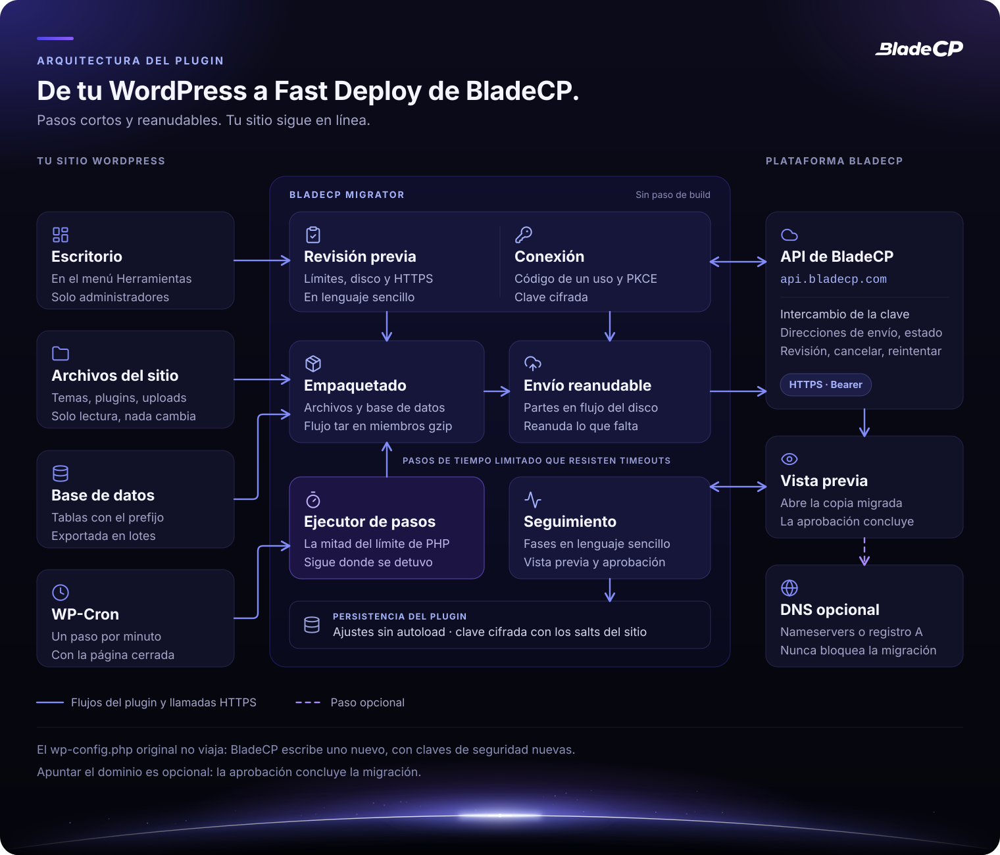
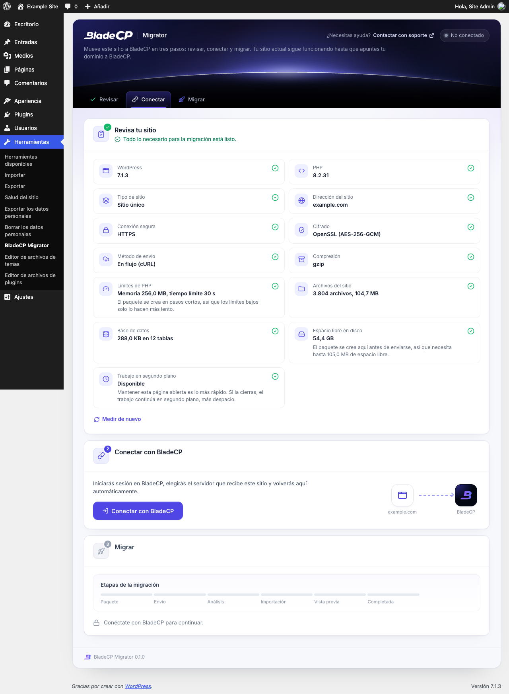
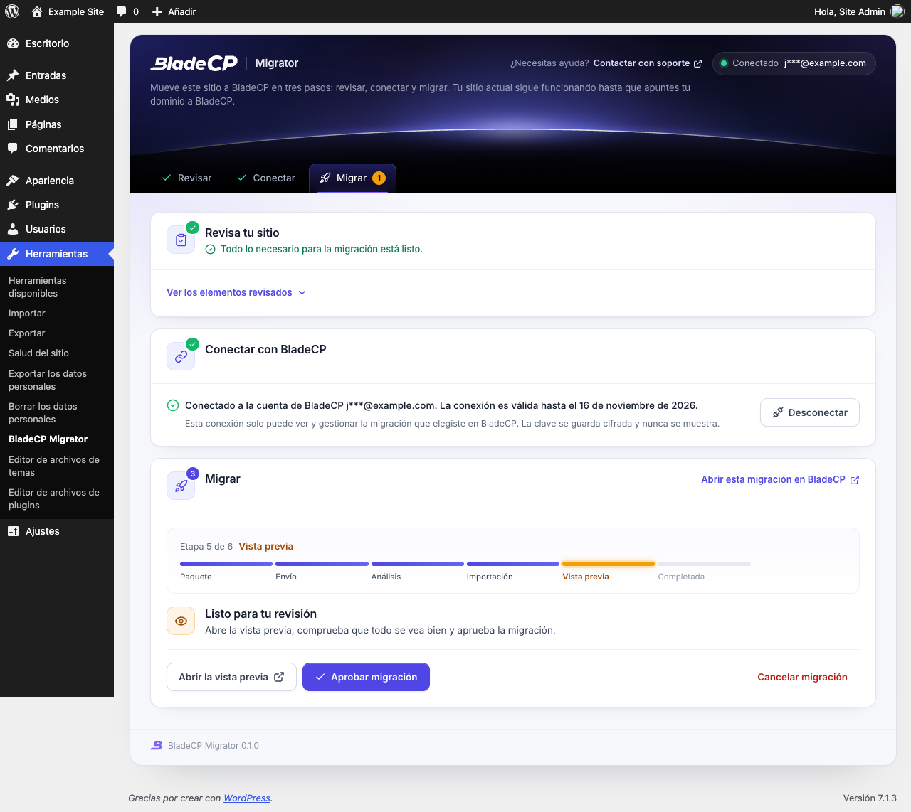

<p align="center">
  <picture>
    <source media="(max-width: 600px)" srcset="assets/readme/hero-compact.es.svg">
    
  </picture>
</p>

<p align="center">
  <strong>Mueve un sitio WordPress a Fast Deploy de BladeCP en pocos clics.</strong><br>
  El plugin oficial de código abierto que revisa, empaqueta y envía tu sitio, y sigue la migración hasta que la apruebas.
</p>

<p align="center">
  <a href="CHANGELOG.md"></a>
  <a href="#requisitos"></a>
  <a href="#requisitos"></a>
  <a href="#requisitos"></a><br>
  <a href="#calidad"></a>
  <a href="#calidad"></a>
  <a href="LICENSE"></a>
</p>

<p align="center">
  <a href="https://github.com/bladecp/bladecp-wordpress/releases/download/v0.1.0/bladecp-migrator-0.1.0.zip"><strong>Descargar BladeCP Migrator (.zip)</strong></a>
  &nbsp;·&nbsp;
  <a href="https://github.com/bladecp/bladecp-wordpress/releases/tag/v0.1.0">Notas de la versión</a>
  &nbsp;·&nbsp;
  <a href="https://github.com/bladecp/bladecp-wordpress/releases/download/v0.1.0/SHA256SUMS">Checksum SHA-256</a>
</p>

<p align="center">
  <a href="#funcionalidades">Funcionalidades</a> ·
  <a href="#arquitectura">Arquitectura</a> ·
  <a href="#instalacion">Instalación</a> ·
  <a href="#como-funciona">Cómo funciona</a> ·
  <a href="#servicios-externos">Servicios externos</a> ·
  <a href="#seguridad">Seguridad</a> ·
  <a href="#calidad">Calidad</a> ·
  <a href="#preguntas">Preguntas</a> ·
  <a href="#soporte">Soporte</a>
  <br>
  <sub><a href="README.md">English</a> · <a href="README.pt-BR.md">Português (Brasil)</a></sub>
</p>

> [!NOTE]
> **BladeCP Migrator `0.1.0`** es la primera versión pública. Mueve un sitio a
> BladeCP, un servicio de hosting externo, así que necesitas una cuenta de
> BladeCP para conectar. No se envía nada antes de que lo uses.

BladeCP Migrator es el plugin oficial de código abierto que mueve **un sitio
WordPress** a **Fast Deploy de BladeCP**. Todo el flujo está en una sola
pantalla en **Herramientas > BladeCP Migrator**: revisar el sitio, conectar con
BladeCP, iniciar la migración, comprobar la vista previa y aprobar. Tu sitio
actual sigue funcionando todo el tiempo, y el plugin solo lo lee.

<a id="funcionalidades"></a>

## Pensado para hostings comunes

| Una pantalla | Pasos cortos y reanudables | Tu aprobación |
| --- | --- | --- |
| Revisar, conectar y migrar desde **Herramientas**, con mensajes en lenguaje sencillo y una ruta de seis etapas de la migración. | Cada paso tiene un tiempo limitado y guarda su progreso, así que los límites bajos de PHP y los timeouts solo hacen el trabajo más lento. | BladeCP crea una vista previa de la copia migrada. Aprobar concluye la migración; apuntar el dominio es opcional. |

### Qué hace

- **Revisa el sitio primero.** Versiones de WordPress y PHP, tipo de sitio,
  HTTPS, cifrado, límites de PHP, archivos, base de datos y espacio libre en
  disco, con todo lo que impide la migración explicado antes de conectar.
- **Conecta sin copiar claves.** Inicias sesión en BladeCP en el navegador,
  eliges el servidor que recibe el sitio y vuelves automáticamente.
- **Empaqueta archivos y base de datos.** Un flujo tar en miembros gzip y una
  exportación de la base de datos en lotes pequeños, compatible con
  `mysqldump`, escritos sin ZipArchive, sin comandos de shell y sin cargar
  archivos en memoria.
- **Envía en partes reanudables.** Las partes salen del disco en flujo; un
  envío interrumpido se reanuda sin volver a enviar lo que BladeCP ya tiene.
- **Sigue la migración.** Fases en lenguaje sencillo, el enlace de la vista
  previa, la confirmación del dominio cuando BladeCP la pide y las acciones
  para aprobar, cancelar o reintentar.
- **No deja nada atrás.** "Desconectar" elimina la clave en cualquier momento,
  y eliminar el plugin borra sus ajustes, la tarea programada y la carpeta de
  trabajo.

### Qué se migra y qué no

Se migra: todos los archivos de la carpeta de WordPress y las tablas de la base
de datos con el prefijo de tablas del sitio.

No se migra: carpetas de caché y archivos de otros plugins de copias de
seguridad, el `wp-config.php` original (BladeCP escribe uno nuevo con las
credenciales de la nueva base de datos y claves de seguridad nuevas), enlaces
simbólicos, archivos ilegibles y cuentas de correo.

Aún no compatible: redes Multisite, sitios servidos desde una subcarpeta (por
ejemplo `example.com/blog`), WordPress instalado en su propia carpeta separada
de la dirección del sitio y paquetes de más de 50 GB.

## Arquitectura

El plugin hace el trabajo en tu sitio en pasos cortos y habla con BladeCP solo
por HTTPS, con una clave atada a una migración.

<p align="center">
  <picture>
    <source media="(max-width: 600px)" srcset="assets/readme/architecture-compact.es.svg">
    
  </picture>
</p>

<p align="center"><sub>Vista lógica del plugin. <a href="assets/readme/architecture.es.svg">Abrir el diagrama a tamaño completo</a>.</sub></p>

| Parte | Responsabilidad |
| --- | --- |
| **Pantalla** | Herramientas > BladeCP Migrator, solo para administradores, con nonce en cada acción |
| **Revisión** | Versiones, tipo de sitio, HTTPS, cifrado, límites, archivos, base de datos y disco |
| **Conexión** | Código de un solo uso con PKCE y una clave cifrada atada a una migración |
| **Empaquetado** | Archivos y tablas de la base de datos en un flujo tar de miembros gzip |
| **Envío** | Por partes, en flujo desde el disco, reanudable tras cualquier interrupción |
| **Ejecutor de pasos** | La mitad del límite de tiempo de PHP por paso, impulsado por la página abierta o por WP-Cron |
| **Seguimiento** | Fases, vista previa, confirmación del dominio, aprobación, cancelación y reintento |

<a id="requisitos"></a>

## Requisitos y compatibilidad

| Componente | Requisito |
| --- | --- |
| WordPress | 6.0 o superior. Probado hasta la 7.1. |
| PHP | 7.4 o superior, de 64 bits |
| Cifrado | OpenSSL con AES-256-GCM, o sodium |
| Extensiones de PHP recomendadas | cURL (envío en flujo desde el disco) y zlib (paquete comprimido) |
| Sitio | Un solo sitio servido por HTTPS desde la raíz de su dominio |
| Base de datos | MySQL o MariaDB, según lo que admita tu WordPress |
| Espacio en disco | Espacio libre para crear el paquete junto al sitio; la revisión lo estima |
| Red | HTTPS saliente hacia `api.bladecp.com` y hacia las direcciones de envío que devuelve BladeCP |
| Idiomas | Inglés, portugués (Brasil) y español |
| Cuenta | Una cuenta de BladeCP |

Consulta la [compatibilidad](docs/compatibility.md) (en inglés) para el
resumen de la validación.

<a id="instalacion"></a>

## Instalación

Instala desde el directorio de WordPress.org cuando liste el plugin, o desde
una [release de GitHub](https://github.com/bladecp/bladecp-wordpress/releases),
no desde una instantánea del código. No hay Composer ni paso de build.

1. Descarga `bladecp-migrator-0.1.0.zip` y su archivo `SHA256SUMS`.
2. Verifica el zip desde la carpeta que contiene los dos archivos:

   ```bash
   shasum -a 256 -c SHA256SUMS
   ```

   En Linux, usa `sha256sum -c SHA256SUMS`.

3. En WordPress, abre **Plugins > Añadir nuevo plugin > Subir plugin**, elige
   el zip y haz clic en **Instalar ahora**.
4. Activa el plugin y abre **Herramientas > BladeCP Migrator**.

| Archivo | Para qué sirve |
| --- | --- |
| [**bladecp-migrator-0.1.0.zip**](https://github.com/bladecp/bladecp-wordpress/releases/download/v0.1.0/bladecp-migrator-0.1.0.zip) | Plugin instalable, con una sola carpeta `bladecp-migrator/` |
| [**SHA256SUMS**](https://github.com/bladecp/bladecp-wordpress/releases/download/v0.1.0/SHA256SUMS) | Checksum para verificar el zip |
| [**RELEASE_NOTES.md**](https://github.com/bladecp/bladecp-wordpress/releases/download/v0.1.0/RELEASE_NOTES.md) | Notas que acompañan esta versión |

Los archivos automáticos **Source code** de GitHub contienen el repositorio;
para instalar el plugin, usa el zip de arriba. Consulta la
[guía de instalación](docs/installation.md) (en inglés) para actualizar y
eliminar.

<a id="como-funciona"></a>

## Cómo funciona la migración

1. **Revisa tu sitio.** El plugin mide el sitio en pasos cortos y muestra lo
   que impide la migración, si hay algo, antes de conectar.
2. **Conecta con BladeCP.** El Hub de BladeCP se abre en el navegador. Inicia
   sesión, elige el servidor que recibe el sitio y vuelve automáticamente. El
   plugin recibe una clave que solo funciona para esa migración y caduca en 30
   días.
3. **Inicia la migración.** Un clic crea el paquete y lo envía a BladeCP por
   partes. Mantén la página abierta para avanzar más rápido; si la cierras,
   WP-Cron continúa en segundo plano.
4. **Comprueba y aprueba.** La misma pantalla muestra cada fase. Abre la vista
   previa de la copia migrada, confirma el dominio cuando BladeCP lo pida y
   aprueba. La aprobación concluye la migración.
5. **Apunta el dominio cuando quieras.** Es opcional y nunca bloquea la
   migración: la pantalla muestra los nameservers de BladeCP y, como
   alternativa, el registro A.

| Revisión | Comprobar y aprobar |
| --- | --- |
|  |  |

Las capturas muestran el plugin instalado desde su zip en un WordPress
desechable, con datos neutros como `example.com`. Consulta la
[guía de configuración](docs/configuration.md) (en inglés) para cada paso.

<a id="servicios-externos"></a>

## Servicios externos

El plugin es una interfaz para BladeCP. Solo se comunica con BladeCP después
de que un administrador lo usa; la revisión se ejecuta por completo en tu
sitio.

| Servicio | Cuándo | Qué se envía |
| --- | --- | --- |
| **Hub de BladeCP** (`hub.bladecp.com`) | Haces clic en **Conectar con BladeCP** | El navegador abre el Hub con la dirección de este sitio, la dirección de la pantalla del plugin, un state aleatorio y un desafío PKCE de un solo uso |
| **API de BladeCP** (`api.bladecp.com`) | Al volver del Hub y mientras sigues o actúas sobre la migración | El código de un solo uso y su verificador, después pedidos de direcciones de envío, confirmación del envío, confirmación del dominio, aprobación, cancelación o reintento, con la versión del plugin y el idioma de la pantalla |
| **Almacenamiento de BladeCP** | Después de hacer clic en **Iniciar migración** | El paquete, enviado por partes por HTTPS a las direcciones que devuelve la API: tus archivos de WordPress y las tablas con tu prefijo, nunca tu `wp-config.php` original |

[Términos y condiciones](https://bladecp.com/terms-and-conditions) ·
[Política de privacidad](https://bladecp.com/privacy-policy). La misma
información está en la sección "External services" del
[readme.txt](readme.txt).

<a id="seguridad"></a>

## Seguridad

- **Solo administradores.** La pantalla exige `manage_options`, y cada acción
  comprueba un nonce.
- **Una conexión que no se puede repetir.** El código de un solo uso usa PKCE
  (S256) y un state de tu usuario, de un solo uso, que caduca en 15 minutos.
  La dirección de retorno es siempre la pantalla de administración de este
  sitio.
- **Una clave cifrada para una migración.** La clave se cifra con las claves
  de seguridad del sitio (AES-256-GCM con OpenSSL, o sodium), se guarda en un
  ajuste que no se carga automáticamente, nunca se muestra ni se registra en
  logs, y caduca en 30 días.
- **No sale nada más del sitio.** Las solicitudes van solo a
  `api.bladecp.com`, al Hub en tu navegador y a las direcciones HTTPS de envío
  que devuelve BladeCP. Los ajustes del propio plugin quedan fuera de la
  exportación de la base de datos, así que la clave nunca viaja con el sitio, y
  el `wp-config.php` original nunca se envía.
- **Una carpeta de trabajo protegida.** El paquete se crea en una carpeta con
  nombre aleatorio, bloqueada para el acceso web, y se elimina cuando se
  confirma el envío.
- **Nada de otros sitios.** Fuentes, iconos, estilos y scripts vienen con el
  plugin, y el plugin no escribe logs.

Para informar de una vulnerabilidad en privado, sigue el
[SECURITY.md](SECURITY.md) (en inglés). No incluyas claves, cookies ni datos
del sitio en una issue pública.

<a id="calidad"></a>

## Calidad y validación

La versión `0.1.0` fue validada por los mantenedores con **220 verificaciones
automáticas**: 99 pruebas del plugin, en PHP 8.2, cubren la revisión, la
conexión y PKCE, el cifrado, el formato del paquete, la exportación de la base
de datos, el escritor tar y gzip, el envío reanudable contra un servidor HTTP
local, la pantalla y las traducciones, y otras 121 cubren las herramientas que
crean el árbol público y el zip. La insignia de pruebas representa esa
ejecución.

- **Plugin Check:** ningún error en el zip de la versión, en un WordPress 7.1.3
  desechable, en modo de envío nuevo, con las verificaciones estáticas y de
  ejecución.
- **PHP 7.4:** cada archivo PHP pasa una verificación de sintaxis y de
  compatibilidad con PHP 7.4, además del PHP actual.
- **Hosting modesto:** el zip se instaló solo en WordPress 7.1.3 con 64 MB de
  memoria y 4 segundos de límite de tiempo, y una exportación de la base de
  datos de MariaDB 10.11 se importó de nuevo con checksums de tabla idénticos.
- **Zip reproducible:** los mismos archivos del plugin y la misma fecha de la
  versión siempre dan el mismo zip y el mismo checksum.

Este repositorio incluye la verificación de estructura e higiene
(`scripts/check-public-tree.sh`). El CI público ejecuta la verificación de
sintaxis de PHP 7.4 a 8.4, esa verificación y Plugin Check. Las
verificaciones automáticas no sustituyen una prueba en una copia de tu propio
sitio.

<a id="desarrollo"></a>

## Desarrollo y contribución

Los archivos de este repositorio son los archivos que se distribuyen: no hay
paso de build ni dependencia de Composer. Mantén el código compatible con
PHP 7.4.

```sh
git clone https://github.com/bladecp/bladecp-wordpress.git
cd bladecp-wordpress
find . -name '*.php' -not -path './.git/*' -print0 | xargs -0 -n1 php -l
bash scripts/check-public-tree.sh
```

```text
bladecp-migrator.php          Cabecera, constantes, autoloader y ganchos
uninstall.php                 Elimina ajustes, tarea programada y carpeta de trabajo
includes/                     Pantalla, conexión, cliente de la API, job y escritor del paquete
assets/css, assets/js         Estilos y script de la pantalla, sin dependencias
assets/fonts                  La fuente Inter incluida (SIL OFL 1.1)
languages/                    Traducciones al portugués (Brasil) y al español
docs/                         Guías de instalación, configuración y operación
assets/readme/                Arte del README
.wordpress-org/               Banners, iconos y capturas de la página del directorio
scripts/check-public-tree.sh  Verificación pública de estructura e higiene
```

Las contribuciones son bienvenidas. Lee el [CONTRIBUTING.md](CONTRIBUTING.md)
(en inglés) antes de abrir una issue o un pull request, mantén los cambios
enfocados, ejecuta Plugin Check en tu cambio y nunca subas claves ni datos de
sitios. Las contribuciones aprobadas siguen el flujo de mantenimiento del
proyecto antes de aparecer en una versión posterior.

| Guía | Qué encontrarás |
| --- | --- |
| [Instalación](docs/installation.md) | Directorio, zip de la versión, checksum, actualización y eliminación |
| [Configuración](docs/configuration.md) | Los tres pasos y el filtro de rutas excluidas |
| [Compatibilidad](docs/compatibility.md) | Requisitos, hosting modesto y resumen de la validación |
| [Solución de problemas](docs/troubleshooting.md) | Conexión, progreso, espacio en disco y archivos omitidos |
| [Proceso de release](docs/release-process.md) | Cómo se preparan y verifican las versiones públicas |
| [Gobernanza del repositorio](docs/repository-governance.md) | Issues, pull requests, historial y versiones |
| [Changelog](CHANGELOG.md) | Cambios de cada versión pública |

Las guías están en inglés.

<a id="preguntas"></a>

## Preguntas frecuentes

<details>
<summary><strong>¿El plugin cambia mi sitio actual?</strong></summary>

No. Lee tus archivos y tu base de datos para crear el paquete. Tu sitio sigue
funcionando hasta que apuntes tu dominio a BladeCP.

</details>

<details>
<summary><strong>¿Necesito una cuenta de BladeCP?</strong></summary>

Sí. Inicias sesión en BladeCP al conectar y eliges allí el servidor que recibe
el sitio.

</details>

<details>
<summary><strong>¿Se envía la contraseña de mi base de datos a BladeCP?</strong></summary>

No. El paquete no incluye tu `wp-config.php` original. BladeCP escribe uno
nuevo para el nuevo servidor, con claves de seguridad nuevas.

</details>

<details>
<summary><strong>Mi hosting tiene límites bajos de PHP. ¿Funcionará?</strong></summary>

Normalmente sí. El plugin trabaja en pasos cortos y sigue donde se detuvo, así
que los límites bajos solo lo hacen más lento. La revisión avisa cuando algo
realmente impide la migración, como la falta de espacio en disco.

</details>

<details>
<summary><strong>¿Qué pasa si cierro la página?</strong></summary>

El trabajo continúa en segundo plano con WP-Cron, más despacio. Cuando WP-Cron
está desactivado en tu sitio, mantén la página abierta.

</details>

<details>
<summary><strong>¿Tengo que apuntar mi dominio a BladeCP?</strong></summary>

No. La aprobación concluye la migración. Apuntar el dominio es opcional, y la
pantalla muestra los nameservers de BladeCP o el registro A para cuando
quieras.

</details>

<details>
<summary><strong>¿Cómo elimino todo lo que creó el plugin?</strong></summary>

Elimina el plugin en **Plugins**. Borra sus ajustes, los transients, la tarea
programada y la carpeta de trabajo. Una migración que ya está en BladeCP no se
cancela.

</details>

<a id="soporte"></a>

## Soporte

| Asunto | Canal |
| --- | --- |
| Ayuda con una migración | El enlace **Contactar con soporte** en la pantalla del plugin |
| Error reproducible o pedido de producto | [GitHub Issues](https://github.com/bladecp/bladecp-wordpress/issues) |
| Preguntas técnicas | [dev@bladecp.com](mailto:dev@bladecp.com) |
| Vulnerabilidad | [Política de seguridad](SECURITY.md) |

En los informes públicos, usa datos neutros. Mantén las claves, las cookies y
los datos del sitio en canales privados.

## Licencia

BladeCP Migrator se distribuye bajo la [licencia MIT](LICENSE), con copyright
de BladeCP. La fuente Inter incluida usa la SIL Open Font License 1.1
([assets/fonts/OFL.txt](assets/fonts/OFL.txt)) y los iconos Lucide usan la
licencia ISC ([includes/LICENSE-lucide.txt](includes/LICENSE-lucide.txt)). La
licencia del plugin no sustituye los términos de los servicios de BladeCP.

<p align="center"><strong>BladeCP. Tu sitio, nuestra infraestructura.</strong></p>
