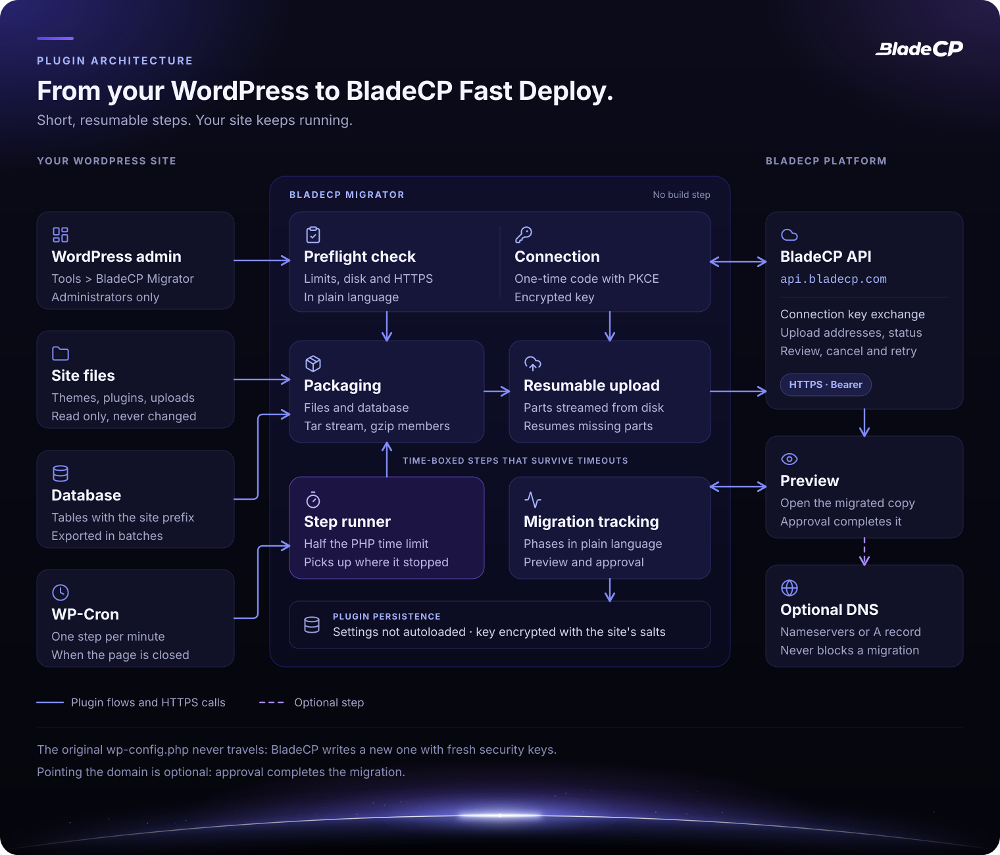
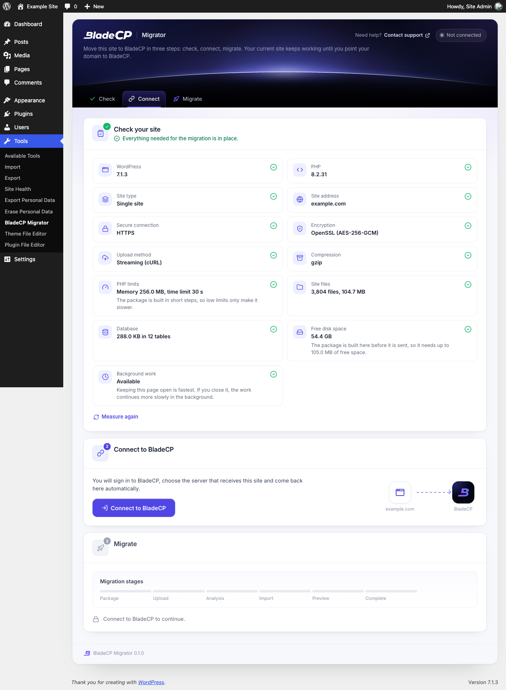
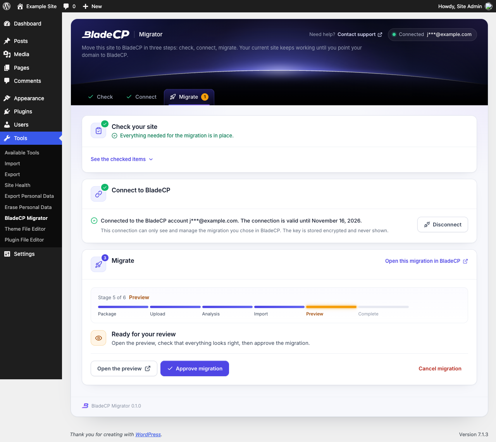

<p align="center">
  <picture>
    <source media="(max-width: 600px)" srcset="assets/readme/hero-compact.en.svg">
    
  </picture>
</p>

<p align="center">
  <strong>Move a WordPress site to BladeCP Fast Deploy in a few clicks.</strong><br>
  The official open-source plugin that checks, packages and uploads your site, then follows the migration until you approve it.
</p>

<p align="center">
  <a href="CHANGELOG.md"></a>
  <a href="#requirements"></a>
  <a href="#requirements"></a>
  <a href="#requirements"></a><br>
  <a href="#quality"></a>
  <a href="#quality"></a>
  <a href="LICENSE"></a>
</p>

<p align="center">
  <a href="https://github.com/bladecp/bladecp-wordpress/releases/download/v0.1.0/bladecp-migrator-0.1.0.zip"><strong>Download BladeCP Migrator (.zip)</strong></a>
  &nbsp;·&nbsp;
  <a href="https://github.com/bladecp/bladecp-wordpress/releases/tag/v0.1.0">Release notes</a>
  &nbsp;·&nbsp;
  <a href="https://github.com/bladecp/bladecp-wordpress/releases/download/v0.1.0/SHA256SUMS">SHA-256 checksum</a>
</p>

<p align="center">
  <a href="#features">Features</a> ·
  <a href="#architecture">Architecture</a> ·
  <a href="#installation">Installation</a> ·
  <a href="#how-the-migration-works">How it works</a> ·
  <a href="#external-services">External services</a> ·
  <a href="#security">Security</a> ·
  <a href="#quality">Quality</a> ·
  <a href="#faq">FAQ</a> ·
  <a href="#support">Support</a>
  <br>
  <sub><a href="README.pt-BR.md">Português (Brasil)</a> · <a href="README.es.md">Español</a></sub>
</p>

> [!NOTE]
> **BladeCP Migrator `0.1.0`** is the first public release. It moves a site to
> BladeCP, an external hosting service, so you need a BladeCP account to
> connect. Nothing is sent before you use it.

BladeCP Migrator is the official open-source plugin that moves **one
WordPress site** to **BladeCP Fast Deploy**. The whole flow lives on one screen
under **Tools > BladeCP Migrator**: check the site, connect to BladeCP, start
the migration, review the preview and approve. Your current site keeps working
the whole time, and the plugin only reads from it.

<a id="features"></a>

## Built for ordinary hosting

| One screen | Short, resumable steps | Your approval |
| --- | --- | --- |
| Check, connect and migrate from **Tools**, with plain-language messages and a six-stage trail of the migration. | Every step is time-boxed and saves its progress, so low PHP limits and timeouts only make the work slower. | BladeCP builds a preview of the migrated copy. Approving completes the migration; pointing the domain is optional. |

### What it does

- **Checks the site first.** WordPress and PHP versions, site type, HTTPS,
  encryption support, PHP limits, files, database and free disk space, with
  anything that blocks the migration explained before you connect.
- **Connects without copying keys.** You sign in to BladeCP in the browser,
  choose the server that receives the site and come back automatically.
- **Packages files and database.** A tar stream in gzip members and a
  database export in small batches, compatible with `mysqldump`, written
  without ZipArchive, shell commands or loading files into memory.
- **Uploads in resumable parts.** Parts are streamed from disk; an
  interrupted upload resumes without sending again what BladeCP already has.
- **Follows the migration.** Phases in plain language, the preview link, the
  domain confirmation when BladeCP asks for it, and the actions to approve,
  cancel or retry.
- **Leaves nothing behind.** Disconnect removes the key at any time, and
  deleting the plugin removes its settings, scheduled task and working folder.

### What is moved and what is not

Moved: every file of the WordPress folder and the database tables with the
site's table prefix.

Not moved: cache folders and archives of other backup plugins, the original
`wp-config.php` (BladeCP writes a new one with the new database credentials and
fresh security keys), symbolic links, unreadable files and email accounts.

Not supported yet: Multisite networks, sites served from a subfolder (for
example `example.com/blog`), WordPress installed in its own folder apart from
the site address, and packages larger than 50 GB.

## Architecture

The plugin keeps the work on your site in short steps and talks to BladeCP only
over HTTPS, with a key bound to one migration.

<p align="center">
  <picture>
    <source media="(max-width: 600px)" srcset="assets/readme/architecture-compact.en.svg">
    
  </picture>
</p>

<p align="center"><sub>Logical view of the plugin. <a href="assets/readme/architecture.en.svg">Open the diagram at full size</a>.</sub></p>

| Part | Responsibility |
| --- | --- |
| **Screen** | Tools > BladeCP Migrator, for administrators only, with a nonce on every action |
| **Check** | Versions, site type, HTTPS, encryption, limits, files, database and disk space |
| **Connection** | One-time code with PKCE and an encrypted key bound to one migration |
| **Packaging** | Files and database tables in a tar stream of gzip members |
| **Upload** | Multipart, streamed from disk, resumable after any interruption |
| **Step runner** | Half the PHP time limit per step, driven by the open page or by WP-Cron |
| **Tracking** | Phases, preview, domain confirmation, approval, cancel and retry |

<a id="requirements"></a>

## Requirements and compatibility

| Component | Requirement |
| --- | --- |
| WordPress | 6.0 or newer. Tested up to 7.1. |
| PHP | 7.4 or newer, 64-bit |
| Encryption | OpenSSL with AES-256-GCM, or sodium |
| Recommended PHP extensions | cURL (uploads streamed from disk) and zlib (compressed package) |
| Site | A single site served over HTTPS from the root of its domain |
| Database | MySQL or MariaDB, as supported by your WordPress |
| Disk space | Enough free space to build the package next to the site; the check estimates it |
| Network | Outbound HTTPS to `api.bladecp.com` and to the upload addresses BladeCP returns |
| Languages | English, Portuguese (Brazil) and Spanish |
| Account | A BladeCP account |

See [compatibility](docs/compatibility.md) for the validation snapshot.

<a id="installation"></a>

## Installation

Install from the WordPress.org directory when it lists the plugin, or from a
[GitHub Release](https://github.com/bladecp/bladecp-wordpress/releases), not
from a source snapshot. No Composer or build step is needed.

1. Download `bladecp-migrator-0.1.0.zip` and its `SHA256SUMS` file.
2. Verify the zip from the folder that holds both files:

   ```bash
   shasum -a 256 -c SHA256SUMS
   ```

   On Linux, run `sha256sum -c SHA256SUMS` instead.

3. In WordPress, open **Plugins > Add New Plugin > Upload Plugin**, choose the
   zip and click **Install Now**.
4. Activate the plugin and open **Tools > BladeCP Migrator**.

| File | Purpose |
| --- | --- |
| [**bladecp-migrator-0.1.0.zip**](https://github.com/bladecp/bladecp-wordpress/releases/download/v0.1.0/bladecp-migrator-0.1.0.zip) | Installable plugin, with a single `bladecp-migrator/` folder |
| [**SHA256SUMS**](https://github.com/bladecp/bladecp-wordpress/releases/download/v0.1.0/SHA256SUMS) | Checksum to verify the zip |
| [**RELEASE_NOTES.md**](https://github.com/bladecp/bladecp-wordpress/releases/download/v0.1.0/RELEASE_NOTES.md) | Notes that accompany this version |

The automatic **Source code** archives from GitHub contain the repository; to
install the plugin, use the zip above. See the
[installation guide](docs/installation.md) for updates and removal.

<a id="how-the-migration-works"></a>

## How the migration works

1. **Check your site.** The plugin measures the site in short steps and shows
   what blocks the migration, if anything, before you connect.
2. **Connect to BladeCP.** The BladeCP Hub opens in your browser. Sign in,
   choose the server that receives the site and come back automatically. The
   plugin receives a key that only works for that migration and expires after
   30 days.
3. **Start the migration.** One click builds the package and sends it to
   BladeCP in parts. Keep the page open for the fastest progress; if you close
   it, WP-Cron continues in the background.
4. **Review and approve.** The same screen shows each phase. Open the preview
   of the migrated copy, confirm the domain when BladeCP asks for it, and
   approve. Approval completes the migration.
5. **Point the domain whenever you want.** It is optional and never blocks the
   migration: the screen shows the BladeCP nameservers and, as an alternative,
   the A record.

| Check | Review and approve |
| --- | --- |
|  |  |

The captures show the plugin installed from its zip in a disposable WordPress
with neutral data, such as `example.com`. See the
[configuration guide](docs/configuration.md) for each step.

<a id="external-services"></a>

## External services

The plugin is an interface to BladeCP. It contacts BladeCP only after an
administrator uses it; the check runs entirely on your site.

| Service | When | What is sent |
| --- | --- | --- |
| **BladeCP Hub** (`hub.bladecp.com`) | You click **Connect to BladeCP** | Your browser opens the Hub with this site's address, the address of the plugin screen, a random state and a one-time PKCE challenge |
| **BladeCP API** (`api.bladecp.com`) | When you come back from the Hub and while you follow or act on the migration | The one-time code and its verifier, then requests for upload addresses, upload confirmation, domain confirmation, approval, cancel or retry, with the plugin version and the screen language |
| **BladeCP storage** | After you click **Start migration** | The package, sent in parts over HTTPS to the addresses the API returns: your WordPress files and the tables with your prefix, never your original `wp-config.php` |

[Terms and conditions](https://bladecp.com/terms-and-conditions) ·
[Privacy policy](https://bladecp.com/privacy-policy). The same disclosure is in
the "External services" section of [readme.txt](readme.txt).

## Security

- **Administrators only.** The screen requires `manage_options`, and every
  action checks a nonce.
- **A connection that cannot be replayed.** The one-time code uses PKCE (S256)
  and a single-use state of your user that expires in 15 minutes. The return
  address is always this site's own admin page.
- **An encrypted key for one migration.** The key is encrypted with the site's
  security keys (AES-256-GCM through OpenSSL, or sodium), kept in a setting
  that is not autoloaded, never displayed or logged, and it expires after 30
  days.
- **Nothing extra leaves the site.** Requests go only to `api.bladecp.com`, to
  the Hub in your browser and to the HTTPS upload addresses BladeCP returns.
  The plugin's own settings stay out of the database export, so the key never
  travels with the site, and the original `wp-config.php` is never sent.
- **A protected working folder.** The package is built in a randomly named
  folder that blocks web access, and it is deleted after the upload is
  confirmed.
- **Nothing from other sites.** Fonts, icons, styles and scripts ship with the
  plugin, and the plugin writes no logs.

To report a vulnerability privately, follow [SECURITY.md](SECURITY.md). Please
do not include keys, cookies or site data in a public issue.

<a id="quality"></a>

## Quality and validation

Version `0.1.0` was validated by the maintainers with **220 automated
checks**: 99 plugin tests, on PHP 8.2, cover the check, the connection and
PKCE, encryption, the package format, the database export, the tar and gzip
writer, the resumable upload against a local HTTP server, the screen and the
translations, and 121 more cover the tooling that builds the public tree and
the zip. The tests badge represents that run.

- **Plugin Check:** no errors on the release zip, in a disposable WordPress
  7.1.3, in new-submission mode with the static and runtime checks.
- **PHP 7.4:** every PHP file passes a syntax and compatibility check for
  PHP 7.4 as well as the current PHP.
- **Modest hosting:** the zip was installed on its own in WordPress 7.1.3 with
  a 64 MB memory limit and a 4 second time limit, and a database export from
  MariaDB 10.11 was imported again with identical table checksums.
- **Reproducible zip:** the same plugin files and release date always give the
  same zip and checksum.

This repository includes the structure and hygiene gate
(`scripts/check-public-tree.sh`). The public CI runs the PHP syntax check on
PHP 7.4 to 8.4, the gate and Plugin Check. Automated checks do not replace a
test on a copy of your own site.

<a id="development"></a>

## Development and contributing

The files of this repository are the files that ship: there is no build step
and no Composer dependency. Keep the code compatible with PHP 7.4.

```sh
git clone https://github.com/bladecp/bladecp-wordpress.git
cd bladecp-wordpress
find . -name '*.php' -not -path './.git/*' -print0 | xargs -0 -n1 php -l
bash scripts/check-public-tree.sh
```

```text
bladecp-migrator.php          Plugin header, constants, autoloader and hooks
uninstall.php                 Removes settings, scheduled task and working folder
includes/                     Screen, connection, API client, job and package writer
assets/css, assets/js         Screen styles and script, with no dependencies
assets/fonts                  The bundled Inter typeface (SIL OFL 1.1)
languages/                    Portuguese (Brazil) and Spanish translations
docs/                         Installation, configuration and operation guides
assets/readme/                README artwork
.wordpress-org/               Banners, icons and screenshots of the directory page
scripts/check-public-tree.sh  Public structure and hygiene gate
```

Contributions are welcome. Read [CONTRIBUTING.md](CONTRIBUTING.md) before
opening an issue or pull request, keep changes focused, run Plugin Check on
your change, and never commit keys or site data. Approved contributions follow
the project maintenance workflow before they appear in a later release.

| Guide | What you will find |
| --- | --- |
| [Installation](docs/installation.md) | Directory, release zip, checksum, updates and removal |
| [Configuration](docs/configuration.md) | The three steps and the excluded paths filter |
| [Compatibility](docs/compatibility.md) | Requirements, modest hosting and validation snapshot |
| [Troubleshooting](docs/troubleshooting.md) | Connection, progress, disk space and skipped files |
| [Release process](docs/release-process.md) | How public releases are prepared and verified |
| [Repository governance](docs/repository-governance.md) | Issues, pull requests, history and releases |
| [Changelog](CHANGELOG.md) | Changes in each public version |

<a id="faq"></a>

## Frequently asked questions

<details>
<summary><strong>Does the plugin change my current site?</strong></summary>

No. It reads your files and database to build the package. Your site keeps
working until you point your domain to BladeCP.

</details>

<details>
<summary><strong>Do I need a BladeCP account?</strong></summary>

Yes. You sign in to BladeCP when you connect, and you choose there the server
that receives the site.

</details>

<details>
<summary><strong>Is my database password sent to BladeCP?</strong></summary>

No. The package does not include your original `wp-config.php`. BladeCP writes
a new one for the new server, with fresh security keys.

</details>

<details>
<summary><strong>My hosting has low PHP limits. Will it work?</strong></summary>

Usually yes. The plugin works in short steps and picks up where it stopped, so
low limits only make it slower. The check warns you when something really
blocks the migration, such as missing disk space.

</details>

<details>
<summary><strong>What happens if I close the page?</strong></summary>

The work continues in the background through WP-Cron, more slowly. When WP-Cron
is disabled on your site, keep the page open.

</details>

<details>
<summary><strong>Do I have to point my domain to BladeCP?</strong></summary>

No. Approval completes the migration. Pointing the domain is optional, and the
screen shows the BladeCP nameservers or the A record whenever you want to do it.

</details>

<details>
<summary><strong>How do I remove everything the plugin created?</strong></summary>

Delete the plugin in **Plugins**. It removes its settings, transients,
scheduled task and working folder. A migration already in BladeCP is not
cancelled.

</details>

<a id="support"></a>

## Support

| Subject | Channel |
| --- | --- |
| Help with a migration | The **Contact support** link on the plugin screen |
| Reproducible bug or product request | [GitHub Issues](https://github.com/bladecp/bladecp-wordpress/issues) |
| Technical questions | [dev@bladecp.com](mailto:dev@bladecp.com) |
| Vulnerability | [Security policy](SECURITY.md) |

In public reports, use neutral data. Keep keys, cookies and site data in
private channels.

## License

BladeCP Migrator is released under the [MIT License](LICENSE), copyright
BladeCP. The bundled Inter typeface is under the SIL Open Font License 1.1
([assets/fonts/OFL.txt](assets/fonts/OFL.txt)) and the Lucide icons under the
ISC license ([includes/LICENSE-lucide.txt](includes/LICENSE-lucide.txt)). The
plugin license does not replace the terms of BladeCP services.

<p align="center"><strong>BladeCP. Your site, our infrastructure.</strong></p>
