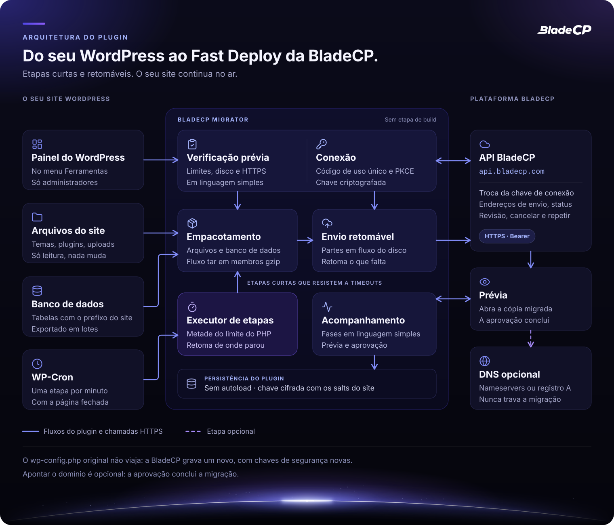
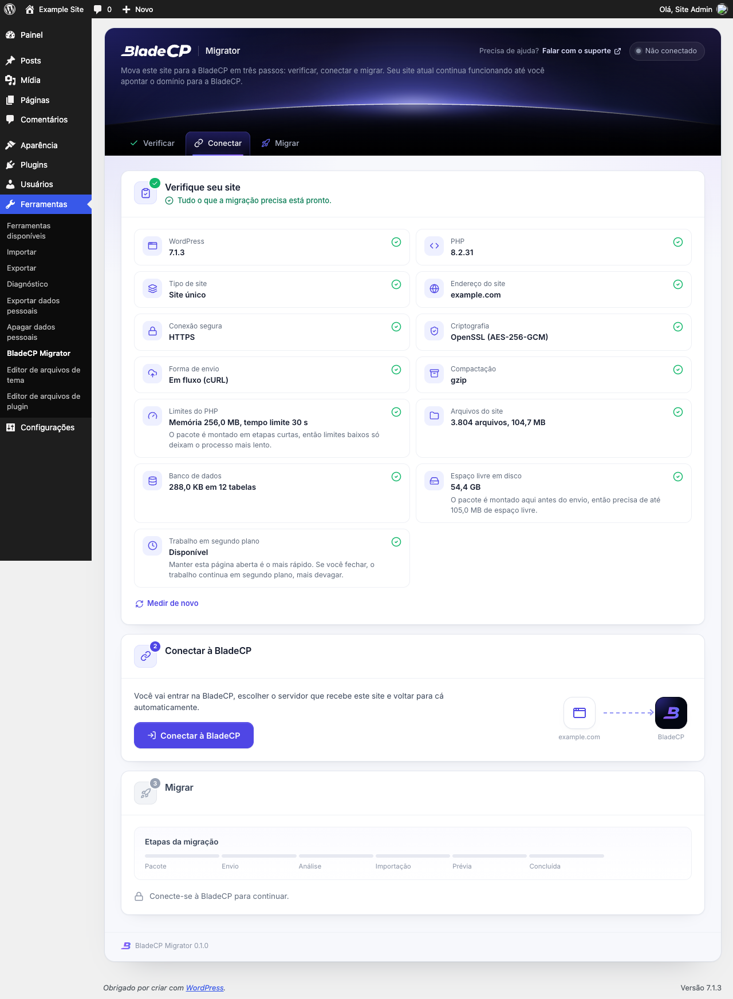
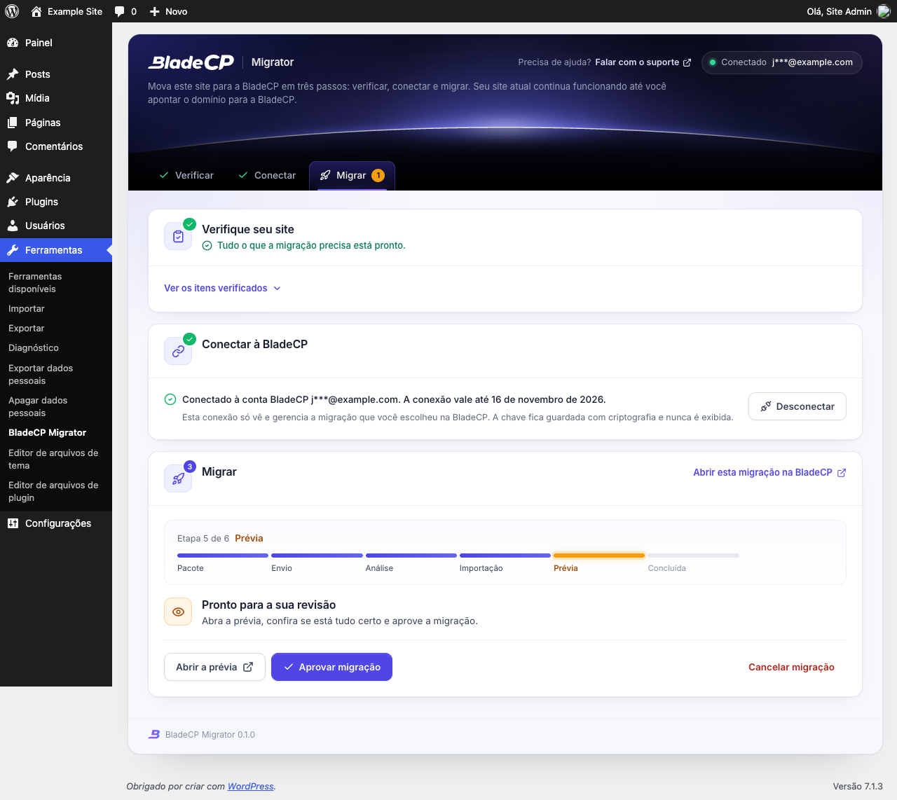

<p align="center">
  <picture>
    <source media="(max-width: 600px)" srcset="assets/readme/hero-compact.pt-BR.svg">
    
  </picture>
</p>

<p align="center">
  <strong>Mova um site WordPress para o Fast Deploy da BladeCP em poucos cliques.</strong><br>
  O plugin oficial e open source que verifica, empacota e envia o seu site, e acompanha a migração até você aprovar.
</p>

<p align="center">
  <a href="CHANGELOG.md"></a>
  <a href="#requisitos"></a>
  <a href="#requisitos"></a>
  <a href="#requisitos"></a><br>
  <a href="#qualidade"></a>
  <a href="#qualidade"></a>
  <a href="LICENSE"></a>
</p>

<p align="center">
  <a href="https://github.com/bladecp/bladecp-wordpress/releases/download/v0.1.0/bladecp-migrator-0.1.0.zip"><strong>Baixar o BladeCP Migrator (.zip)</strong></a>
  &nbsp;·&nbsp;
  <a href="https://github.com/bladecp/bladecp-wordpress/releases/tag/v0.1.0">Notas da versão</a>
  &nbsp;·&nbsp;
  <a href="https://github.com/bladecp/bladecp-wordpress/releases/download/v0.1.0/SHA256SUMS">Checksum SHA-256</a>
</p>

<p align="center">
  <a href="#recursos">Recursos</a> ·
  <a href="#arquitetura">Arquitetura</a> ·
  <a href="#instalacao">Instalação</a> ·
  <a href="#como-funciona">Como funciona</a> ·
  <a href="#servicos-externos">Serviços externos</a> ·
  <a href="#seguranca">Segurança</a> ·
  <a href="#qualidade">Qualidade</a> ·
  <a href="#perguntas">Perguntas</a> ·
  <a href="#suporte">Suporte</a>
  <br>
  <sub><a href="README.md">English</a> · <a href="README.es.md">Español</a></sub>
</p>

> [!NOTE]
> **BladeCP Migrator `0.1.0`** é a primeira versão pública. Ele move um site
> para a BladeCP, um serviço de hospedagem externo, então você precisa de uma
> conta BladeCP para conectar. Nada é enviado antes de você usar.

O BladeCP Migrator é o plugin oficial e open source que move **um site
WordPress** para o **Fast Deploy da BladeCP**. Todo o fluxo fica em uma única
tela em **Ferramentas > BladeCP Migrator**: verificar o site, conectar à
BladeCP, iniciar a migração, revisar a prévia e aprovar. O site atual continua
funcionando o tempo todo, e o plugin só faz leituras nele.

<a id="recursos"></a>

## Feito para hospedagens comuns

| Uma tela | Etapas curtas e retomáveis | A sua aprovação |
| --- | --- | --- |
| Verificar, conectar e migrar em **Ferramentas**, com mensagens em linguagem simples e uma trilha de seis etapas da migração. | Cada etapa tem tempo limitado e salva o progresso, então limites baixos do PHP e timeouts só deixam o trabalho mais lento. | A BladeCP monta uma prévia da cópia migrada. Aprovar conclui a migração; apontar o domínio é opcional. |

### O que ele faz

- **Verifica o site antes.** Versões do WordPress e do PHP, tipo de site,
  HTTPS, suporte a criptografia, limites do PHP, arquivos, banco de dados e
  espaço livre em disco, com tudo o que impede a migração explicado antes de
  conectar.
- **Conecta sem copiar chaves.** Você entra na BladeCP pelo navegador, escolhe
  o servidor que recebe o site e volta automaticamente.
- **Empacota arquivos e banco de dados.** Um fluxo tar em membros gzip e uma
  exportação do banco em lotes pequenos, compatível com o `mysqldump`, gravados
  sem ZipArchive, sem comandos de shell e sem carregar arquivos na memória.
- **Envia em partes retomáveis.** As partes saem do disco em fluxo; um envio
  interrompido é retomado sem reenviar o que a BladeCP já recebeu.
- **Acompanha a migração.** Fases em linguagem simples, o link da prévia, a
  confirmação do domínio quando a BladeCP pedir e as ações para aprovar,
  cancelar ou tentar de novo.
- **Não deixa nada para trás.** "Desconectar" remove a chave a qualquer
  momento, e excluir o plugin remove as configurações, a tarefa agendada e a
  pasta de trabalho.

### O que é migrado e o que não é

Migrado: todos os arquivos da pasta do WordPress e as tabelas do banco de dados
com o prefixo de tabelas do site.

Não migrado: pastas de cache e arquivos de outros plugins de backup, o
`wp-config.php` original (a BladeCP grava um novo com as credenciais do novo
banco de dados e chaves de segurança novas), links simbólicos, arquivos
ilegíveis e contas de e-mail.

Ainda não compatível: redes Multisite, sites servidos a partir de uma subpasta
(por exemplo `example.com/blog`), WordPress instalado em uma pasta própria
separada do endereço do site e pacotes maiores que 50 GB.

## Arquitetura

O plugin faz o trabalho no seu site em etapas curtas e fala com a BladeCP só
por HTTPS, com uma chave presa a uma migração.

<p align="center">
  <picture>
    <source media="(max-width: 600px)" srcset="assets/readme/architecture-compact.pt-BR.svg">
    
  </picture>
</p>

<p align="center"><sub>Visão lógica do plugin. <a href="assets/readme/architecture.pt-BR.svg">Abrir o diagrama em tamanho real</a>.</sub></p>

| Parte | Responsabilidade |
| --- | --- |
| **Tela** | Ferramentas > BladeCP Migrator, só para administradores, com nonce em toda ação |
| **Verificação** | Versões, tipo de site, HTTPS, criptografia, limites, arquivos, banco e disco |
| **Conexão** | Código de uso único com PKCE e uma chave criptografada presa a uma migração |
| **Empacotamento** | Arquivos e tabelas do banco em um fluxo tar de membros gzip |
| **Envio** | Em partes, em fluxo a partir do disco, retomável depois de qualquer interrupção |
| **Executor de etapas** | Metade do limite de tempo do PHP por etapa, conduzido pela página aberta ou pelo WP-Cron |
| **Acompanhamento** | Fases, prévia, confirmação do domínio, aprovação, cancelamento e nova tentativa |

<a id="requisitos"></a>

## Requisitos e compatibilidade

| Componente | Requisito |
| --- | --- |
| WordPress | 6.0 ou superior. Testado até a 7.1. |
| PHP | 7.4 ou superior, 64 bits |
| Criptografia | OpenSSL com AES-256-GCM, ou sodium |
| Extensões recomendadas do PHP | cURL (envio em fluxo a partir do disco) e zlib (pacote compactado) |
| Site | Um único site servido por HTTPS a partir da raiz do domínio |
| Banco de dados | MySQL ou MariaDB, como o seu WordPress suporta |
| Espaço em disco | Espaço livre para montar o pacote ao lado do site; a verificação estima |
| Rede | HTTPS de saída para `api.bladecp.com` e para os endereços de envio que a BladeCP devolve |
| Idiomas | Inglês, português (Brasil) e espanhol |
| Conta | Uma conta BladeCP |

Veja a [compatibilidade](docs/compatibility.md) (em inglês) para o retrato da
validação.

<a id="instalacao"></a>

## Instalação

Instale pelo diretório do WordPress.org quando ele listar o plugin, ou por uma
[release do GitHub](https://github.com/bladecp/bladecp-wordpress/releases), não
por um snapshot do código. Não há Composer nem etapa de build.

1. Baixe o `bladecp-migrator-0.1.0.zip` e o arquivo `SHA256SUMS`.
2. Confira o zip na pasta que tem os dois arquivos:

   ```bash
   shasum -a 256 -c SHA256SUMS
   ```

   No Linux, use `sha256sum -c SHA256SUMS`.

3. No WordPress, abra **Plugins > Adicionar novo plugin > Enviar plugin**,
   escolha o zip e clique em **Instalar agora**.
4. Ative o plugin e abra **Ferramentas > BladeCP Migrator**.

| Arquivo | Para que serve |
| --- | --- |
| [**bladecp-migrator-0.1.0.zip**](https://github.com/bladecp/bladecp-wordpress/releases/download/v0.1.0/bladecp-migrator-0.1.0.zip) | Plugin instalável, com uma única pasta `bladecp-migrator/` |
| [**SHA256SUMS**](https://github.com/bladecp/bladecp-wordpress/releases/download/v0.1.0/SHA256SUMS) | Checksum para conferir o zip |
| [**RELEASE_NOTES.md**](https://github.com/bladecp/bladecp-wordpress/releases/download/v0.1.0/RELEASE_NOTES.md) | Notas que acompanham esta versão |

Os arquivos automáticos **Source code** do GitHub contêm o repositório; para
instalar o plugin, use o zip acima. Veja o
[guia de instalação](docs/installation.md) (em inglês) para atualizar e
remover.

<a id="como-funciona"></a>

## Como funciona a migração

1. **Verifique seu site.** O plugin mede o site em etapas curtas e mostra o que
   impede a migração, se houver, antes de você conectar.
2. **Conecte à BladeCP.** O Hub da BladeCP abre no navegador. Entre na sua
   conta, escolha o servidor que recebe o site e volte automaticamente. O
   plugin recebe uma chave que só funciona para aquela migração e expira em 30
   dias.
3. **Inicie a migração.** Um clique monta o pacote e envia para a BladeCP em
   partes. Deixe a página aberta para o progresso mais rápido; se você fechar,
   o WP-Cron continua em segundo plano.
4. **Revise e aprove.** A mesma tela mostra cada fase. Abra a prévia da cópia
   migrada, confirme o domínio quando a BladeCP pedir e aprove. A aprovação
   conclui a migração.
5. **Aponte o domínio quando quiser.** É opcional e nunca trava a migração: a
   tela mostra os nameservers da BladeCP e, como alternativa, o registro A.

| Verificação | Revisão e aprovação |
| --- | --- |
|  |  |

As capturas mostram o plugin instalado pelo zip em um WordPress descartável,
com dados neutros como `example.com`. Veja o
[guia de configuração](docs/configuration.md) (em inglês) para cada etapa.

<a id="servicos-externos"></a>

## Serviços externos

O plugin é uma interface para a BladeCP. Ele só fala com a BladeCP depois que
um administrador o usa; a verificação roda inteira no seu site.

| Serviço | Quando | O que é enviado |
| --- | --- | --- |
| **Hub da BladeCP** (`hub.bladecp.com`) | Você clica em **Conectar à BladeCP** | O navegador abre o Hub com o endereço deste site, o endereço da tela do plugin, um state aleatório e um desafio PKCE de uso único |
| **API BladeCP** (`api.bladecp.com`) | Na volta do Hub e enquanto você acompanha ou age na migração | O código de uso único e o verificador, depois pedidos de endereços de envio, confirmação do envio, confirmação do domínio, aprovação, cancelamento ou nova tentativa, com a versão do plugin e o idioma da tela |
| **Armazenamento da BladeCP** | Depois que você clica em **Iniciar migração** | O pacote, enviado em partes por HTTPS para os endereços que a API devolve: os arquivos do WordPress e as tabelas com o seu prefixo, nunca o seu `wp-config.php` original |

[Termos e condições](https://bladecp.com/terms-and-conditions) ·
[Política de privacidade](https://bladecp.com/privacy-policy). A mesma
informação está na seção "External services" do [readme.txt](readme.txt).

<a id="seguranca"></a>

## Segurança

- **Só administradores.** A tela exige `manage_options`, e toda ação confere um
  nonce.
- **Uma conexão que não pode ser repetida.** O código de uso único usa PKCE
  (S256) e um state do seu usuário, de uso único, que expira em 15 minutos. O
  endereço de retorno é sempre a tela de administração deste site.
- **Uma chave criptografada para uma migração.** A chave é criptografada com
  as chaves de segurança do site (AES-256-GCM pelo OpenSSL, ou sodium),
  guardada em uma configuração que não é carregada automaticamente, nunca
  exibida nem registrada em log, e expira em 30 dias.
- **Nada além do necessário sai do site.** As requisições vão só para
  `api.bladecp.com`, para o Hub no seu navegador e para os endereços HTTPS de
  envio que a BladeCP devolve. As configurações do próprio plugin ficam fora
  da exportação do banco, então a chave nunca viaja com o site, e o
  `wp-config.php` original nunca é enviado.
- **Uma pasta de trabalho protegida.** O pacote é montado em uma pasta com nome
  aleatório, bloqueada para acesso pela web, e é apagado depois que o envio é
  confirmado.
- **Nada de outros sites.** Fontes, ícones, estilos e scripts vêm com o plugin,
  e o plugin não grava logs.

Para relatar uma vulnerabilidade em particular, siga o
[SECURITY.md](SECURITY.md) (em inglês). Não inclua chaves, cookies nem dados do
site em uma issue pública.

<a id="qualidade"></a>

## Qualidade e validação

A versão `0.1.0` foi validada pelos mantenedores com **220 verificações
automatizadas**: 99 testes do plugin, no PHP 8.2, cobrem a verificação, a
conexão e o PKCE, a criptografia, o formato do pacote, a exportação do banco,
o gravador tar e gzip, o envio retomável contra um servidor HTTP local, a tela
e as traduções, e outras 121 cobrem as ferramentas que montam a árvore pública
e o zip. O selo de testes representa essa execução.

- **Plugin Check:** nenhum erro no zip da versão, em um WordPress 7.1.3
  descartável, no modo de submissão nova, com as verificações estáticas e de
  execução.
- **PHP 7.4:** todo arquivo PHP passa por verificação de sintaxe e de
  compatibilidade com o PHP 7.4, além do PHP atual.
- **Hospedagem modesta:** o zip foi instalado sozinho no WordPress 7.1.3 com
  64 MB de memória e 4 segundos de limite de tempo, e uma exportação do banco
  do MariaDB 10.11 foi importada de novo com checksums de tabela idênticos.
- **Zip reproduzível:** os mesmos arquivos do plugin e a mesma data da versão
  sempre geram o mesmo zip e o mesmo checksum.

Este repositório inclui o portão de estrutura e higiene
(`scripts/check-public-tree.sh`). O CI público roda a verificação de sintaxe
do PHP 7.4 ao 8.4, o portão e o Plugin Check. Verificações automatizadas não
substituem um teste em uma cópia do seu próprio site.

<a id="desenvolvimento"></a>

## Desenvolvimento e contribuição

Os arquivos deste repositório são os arquivos distribuídos: não há etapa de
build nem dependência do Composer. Mantenha o código compatível com o PHP 7.4.

```sh
git clone https://github.com/bladecp/bladecp-wordpress.git
cd bladecp-wordpress
find . -name '*.php' -not -path './.git/*' -print0 | xargs -0 -n1 php -l
bash scripts/check-public-tree.sh
```

```text
bladecp-migrator.php          Cabeçalho, constantes, autoloader e ganchos
uninstall.php                 Remove configurações, tarefa agendada e pasta de trabalho
includes/                     Tela, conexão, cliente da API, job e gravador do pacote
assets/css, assets/js         Estilos e script da tela, sem dependências
assets/fonts                  A fonte Inter incluída (SIL OFL 1.1)
languages/                    Traduções em português (Brasil) e espanhol
docs/                         Guias de instalação, configuração e operação
assets/readme/                Arte do README
.wordpress-org/               Banners, ícones e capturas da página do diretório
scripts/check-public-tree.sh  Portão público de estrutura e higiene
```

Contribuições são bem-vindas. Leia o [CONTRIBUTING.md](CONTRIBUTING.md) (em
inglês) antes de abrir uma issue ou pull request, mantenha as mudanças
focadas, rode o Plugin Check na sua mudança e nunca envie chaves ou dados de
sites. Contribuições aprovadas seguem o fluxo de manutenção do projeto antes de
aparecer em uma versão seguinte.

| Guia | O que você encontra |
| --- | --- |
| [Instalação](docs/installation.md) | Diretório, zip da versão, checksum, atualização e remoção |
| [Configuração](docs/configuration.md) | As três etapas e o filtro de caminhos excluídos |
| [Compatibilidade](docs/compatibility.md) | Requisitos, hospedagem modesta e retrato da validação |
| [Solução de problemas](docs/troubleshooting.md) | Conexão, progresso, espaço em disco e arquivos ignorados |
| [Processo de release](docs/release-process.md) | Como as versões públicas são preparadas e conferidas |
| [Governança do repositório](docs/repository-governance.md) | Issues, pull requests, histórico e versões |
| [Changelog](CHANGELOG.md) | Mudanças de cada versão pública |

Os guias estão em inglês.

<a id="perguntas"></a>

## Perguntas frequentes

<details>
<summary><strong>O plugin muda o meu site atual?</strong></summary>

Não. Ele lê os arquivos e o banco de dados para montar o pacote. O site
continua funcionando até você apontar o domínio para a BladeCP.

</details>

<details>
<summary><strong>Preciso de uma conta BladeCP?</strong></summary>

Sim. Você entra na BladeCP ao conectar e escolhe lá o servidor que recebe o
site.

</details>

<details>
<summary><strong>A senha do meu banco de dados é enviada para a BladeCP?</strong></summary>

Não. O pacote não inclui o seu `wp-config.php` original. A BladeCP grava um
novo para o novo servidor, com chaves de segurança novas.

</details>

<details>
<summary><strong>Minha hospedagem tem limites baixos de PHP. Vai funcionar?</strong></summary>

Normalmente sim. O plugin trabalha em etapas curtas e retoma de onde parou,
então limites baixos só deixam o trabalho mais lento. A verificação avisa
quando algo realmente impede a migração, como falta de espaço em disco.

</details>

<details>
<summary><strong>O que acontece se eu fechar a página?</strong></summary>

O trabalho continua em segundo plano pelo WP-Cron, mais devagar. Quando o
WP-Cron está desativado no seu site, deixe a página aberta.

</details>

<details>
<summary><strong>Preciso apontar o domínio para a BladeCP?</strong></summary>

Não. A aprovação conclui a migração. Apontar o domínio é opcional, e a tela
mostra os nameservers da BladeCP ou o registro A para quando você quiser.

</details>

<details>
<summary><strong>Como removo tudo o que o plugin criou?</strong></summary>

Exclua o plugin em **Plugins**. Ele remove as configurações, os transients, a
tarefa agendada e a pasta de trabalho. Uma migração que já está na BladeCP não
é cancelada.

</details>

<a id="suporte"></a>

## Suporte

| Assunto | Canal |
| --- | --- |
| Ajuda com uma migração | O link **Falar com o suporte** na tela do plugin |
| Bug reproduzível ou pedido de produto | [GitHub Issues](https://github.com/bladecp/bladecp-wordpress/issues) |
| Dúvidas técnicas | [dev@bladecp.com](mailto:dev@bladecp.com) |
| Vulnerabilidade | [Política de segurança](SECURITY.md) |

Em relatos públicos, use dados neutros. Mantenha chaves, cookies e dados do
site em canais privados.

## Licença

O BladeCP Migrator é distribuído sob a [licença MIT](LICENSE), com copyright
da BladeCP. A fonte Inter incluída usa a SIL Open Font License 1.1
([assets/fonts/OFL.txt](assets/fonts/OFL.txt)) e os ícones Lucide usam a
licença ISC ([includes/LICENSE-lucide.txt](includes/LICENSE-lucide.txt)). A
licença do plugin não substitui os termos dos serviços BladeCP.

<p align="center"><strong>BladeCP. O seu site, a nossa infraestrutura.</strong></p>
